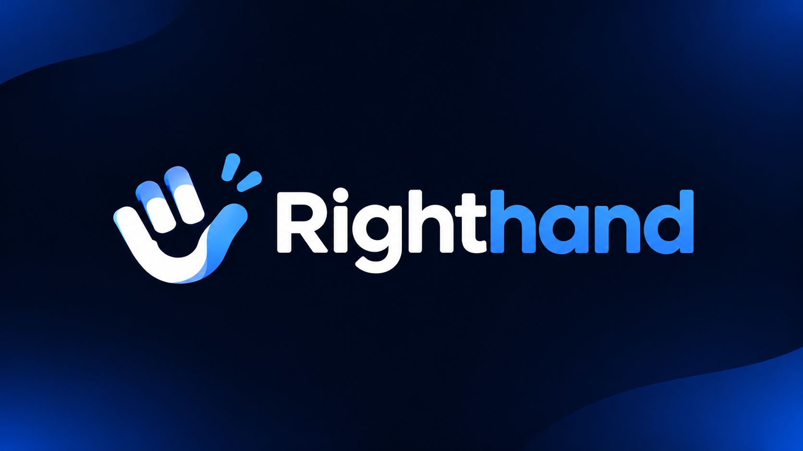

<div align="center">



# RightHand

**Specialist agent personas and multi-agent orchestration engine for Herdr workspaces across coding harnesses.**  
*Persona patterns adapted from Addy Osmani's [agent-skills](https://github.com/addyosmani/agent-skills). SDLC skills adapted from Matt Pocock's [skills](https://github.com/mattpocock/skills).*

[](https://www.typescriptlang.org/)
[](https://www.npmjs.com/package/@agirahman/righthand)
[](https://commandcode.ai/)
[](https://github.com/mario-dn/pi)
[](https://opencode.ai/)
[](https://github.com/can1357/oh-my-pi)
[](https://herdr.dev/)

</div>

---

## Overview

`righthand` acts as your executive second-in-command for multi-agent workflows in [Herdr](https://herdr.dev/) and standalone coding harnesses. It provides a modular persona engine and curated specialist roles designed for autonomous pair-programming, ticket-driven delegation, and workspace isolation across coding harnesses.

Instead of treating an AI agent as a generic monolith, RightHand injects targeted personas via native extensions and hooks across supported harnesses (**Command Code**, **Pi**, **OpenCode**, **Oh My Pi**) or via portable skill standards. Each persona maintains a single perspective, follows rigid output standards, and operates with clear execution boundaries.

### Architectural Principles

- **Single-Perspective Personas**: Each persona embodies a specialized engineering role with a clear evaluation lens, rigid output format, and strict execution boundaries.
- **No Recursive Persona Invocations**: Personas do not invoke other personas at runtime. Multi-agent coordination occurs at the user or palm level across Herdr tabs.
- **Ticket & Worktree Isolation**: Sub-agents communicate through explicit tickets, structured reports, and isolated git worktrees rather than unstructured shared state.
- **Dedicated Harness Folders**: Native extensions and plugins are maintained in clean, harness-specific folders (`.commandcode-mod/`, `.pi-plugin/`, `.omp/`, `.opencode-plugin/`), backed by a unified CLI and state engine.

---

## Persona Catalog

Six personas, named by hand anatomy, covering the whole delivery loop (4 `readonly`, 2 `writer`):

| Profile | Mode | Role Title | Core Focus | Output Framework / Deliverable |
|---|---|---|---|---|
| `palm` | `readonly` | Team Orchestrator | Steering the loop: clarifying and scoping, decomposing work into tickets (`T1`, `T2`), worktree lane assignment, Herdr dispatch, council verdict, integration and release gate | Ticket contract matrix, product spec, worktree plan, council verdict, merge checklist |
| `index` | `readonly` | Software Architect | Pointing the direction: requirements, module boundaries, subsystem contracts, tradeoff analysis | Architecture Decision Record (ADR), A->B->C contract path, PRD and issues |
| `pinky` | `readonly` | Scout and Blast-Radius Investigator | Reading the system before it is written: blast radius, root-cause tracing, existing test scaffolding, defect triage | Blast-radius map with `file:line`, root-cause note, scaffolding inventory, triage entry |
| `thumb` | `writer` | Builder | Building it: API contracts, database queries and migrations, CI/CD determinism, containers, secrets hygiene, general implementation | Status report, minimal file diff, pipeline impact and rollback plan, verification proof |
| `ring` | `writer` | Frontend Engineer | Shaping the interface: semantic HTML, CSS-first layout, state colocation, responsive UX, accessibility (a11y) | Component diff, keyboard/screen-reader audit, visual check proof |
| `middle` | `readonly` | Senior Code Reviewer | Guarding the gate: slice-contract validation, 5-axis code review, security audit (OWASP Top 10), web performance budgets, testing strategy, multi-model review council | Review report (P1-P4 severity) anchored to `file:line`, threat matrix, test matrix, council findings |

### Legacy names

The six personas fold in the eleven earlier ones. Old names still resolve to the
persona that absorbed them, so existing habits, scripts, and `.righthand/persona.json`
files keep working:

| Legacy name | Resolves to |
|---|---|
| `orchestrator`, `product-manager` | `palm` |
| `architect` | `index` |
| `worker`, `backend`, `devops` | `thumb` |
| `frontend` | `ring` |
| `code-reviewer`, `security-auditor`, `test-engineer`, `web-performance-auditor` | `middle` |

### Report contract

Every persona writes its result under `.righthand/` in one shape, so a coordinator and a script read all six the same way. A report or review opens with a YAML envelope holding `ticket`, `persona`, `kind` (`report` or `review`), `status` (`completed`, `partial`, `blocked`), `verdict` (`pass` or `fail`, reviews only), `commit`, and `round`. Three shared sections follow in order: `## Outcome`, `## Verification`, `## Risks & Follow-up`. Each persona then adds only its own extras, for example a blast-radius map for `pinky` or findings by severity for `middle`. The `report-and-board` skill owns the envelope; the profiles own the extras.

A ticket closes only when the board at `.righthand/tickets/<TICKET>/board.jsonl` holds a `done` event and, where a reviewer participated, a `verdict` of `pass`. A report that claims `status: completed` without its `done` event is a contract violation.

---

## Quick Setup

```bash
# 1. Install globally
npm install -g @agirahman/righthand

# 2. Set up a harness (copies or installs the native integration)
righthand setup cmdc        # Command Code (Linux/macOS: cmd, Windows: cmdc)
righthand setup pi          # Pi Coding Agent
righthand setup omp         # Oh My Pi (copies to .omp/extensions/)
righthand setup opencode    # OpenCode (copies two plugins to .opencode/plugins/)
righthand setup all         # Set up every detected harness at once

# 3. Check health
righthand doctor
```

---

## Unified CLI (`righthand`)

RightHand includes a built-in CLI for managing personas and harness integrations.

```bash
# --- Persona Commands ---
righthand list                   # List all six personas + active state
righthand switch thumb           # Activate a persona
righthand switch middle          # (legacy names such as backend or code-reviewer still resolve)
righthand off                    # Deactivate persona (restore default)
righthand inject                 # Print active persona prompt to stdout
righthand init                   # Provision .righthand/ artifact folders in the current project
righthand status                 # One-liner: active persona + setup harnesses
righthand config [persona]       # Resolve dispatch harness and model for a persona
righthand launch <persona>       # Launch an agent for a persona (--print to dry-run)
righthand launch <harness> <persona>  # Pin the harness for one launch (commandcode, pi, omp, opencode)
righthand blast-radius [scope]   # Map blast radius + triage (activates pinky)
righthand council [flags]        # Multi-model council review of a diff (--print to dry-run)
# --- Setup & Maintenance ---
righthand setup <harness|all>    # Install RightHand into a harness
righthand update [harness]       # Re-sync files for omp/opencode after npm update
righthand doctor                 # Health check: PATH, files, active persona

# --- Info ---
righthand -v / --version         # Print version
righthand -h / --help            # Print help
```

Active persona state is stored in `.righthand/state/active-persona.json` (per project, gitignored).

---

## Supported Harnesses & Installation

### 1. Command Code (`.commandcode-mod/`)
RightHand was originally built as a first-class Command Code mod.

- **Install via CLI** (Linux/macOS: `cmd`, Windows: `cmdc` — auto-detected):
  ```bash
  righthand setup cmdc
  # Runs internally: cmdc mods add -g @agirahman/righthand
  # and syncs the sixteen skills to ~/.commandcode/skills
  ```
- **Slash Commands in session**:
  - `/righthand` — open fuzzy picker or show active persona.
  - `/righthand <persona>` — switch persona on-the-fly.
  - `/righthand off` — restore default prompt.
- **Update after npm upgrade**: `righthand update cmdc` (re-syncs the sixteen skills to `~/.commandcode/skills` and removes profiles of retired personas)
- **Details**: See [`.commandcode-mod/README.md`](./.commandcode-mod/README.md).
- Readonly personas are guarded by the mod: project writes are blocked, reports go under `.righthand/`. `palm` alone may also integrate and release: `git fetch`, `git rebase`, `git push` a ticket branch or a version tag, `git add`, `git commit -m`, `git tag v<version>`, `gh pr create/edit` and `gh release create/edit/delete`, plus a version-only write to `package.json` and `package-lock.json`. Still blocked for it: `git commit --amend/--no-verify` or no message, `git tag -d/-f/-e`, force and delete pushes, pushes to `main`, `gh pr merge`, `npm version` and `npm publish`.

### 2. Pi Coding Agent (`.pi-plugin/`)
Pi supports native extensions that hook agent lifecycle events.

- **Install via CLI**:
  ```bash
  righthand setup pi
  # Runs internally: pi install npm:@agirahman/righthand
  ```
- **Slash Command**:
  - `/righthand <persona>` — interactive slash command with full tab-autocomplete for all six personas.
  - `/righthand off` — clear persona.
- **Status Indicator**: Displays current persona badge in the Pi UI status bar.
- **Details**: See [`.pi-plugin/README.md`](./.pi-plugin/README.md).

### 3. Oh My Pi (`.omp/`)
Oh My Pi automatically discovers native extensions placed in `<cwd>/.omp/extensions/`.

- **Setup**:
  ```bash
  righthand setup omp
  # Copies .omp/extensions/righthand.ts into <cwd>/.omp/extensions/
  ```
- **Behavior**: Auto-discovered by OMP runtime without manual plugin trust approval prompts. Hooks `before_agent_start` and registers `/righthand` with interactive picker.
- **Update after npm upgrade**: `righthand update omp`
- **Details**: See [`.omp/README.md`](./.omp/README.md).

### 4. OpenCode (`.opencode-plugin/`)
OpenCode uses the native `@opencode/plugin` and `@opencode/plugin/tui` APIs.

- **Setup**:
  ```bash
  righthand setup opencode
  # Copies one plugin directory into ~/.config/opencode/plugins/righthand/
  ```
- **One plugin directory installed**:
  - `righthand/index.js` — injects active persona into system prompt on every session context event (hooks `session.hook("context")`).
  - `righthand/tui.js` — registers native `/righthand` slash command with interactive persona picker, footer status indicator, and toast notifications. State is stored per session in `~/.local/state/opencode/righthand.json`.
- **Slash Command**: `/righthand <persona>` | `/righthand off` | `/righthand list` | `/righthand` (picker)
- **Update after npm upgrade**: `righthand update opencode`
- **Details**: See [`.opencode-plugin/README.md`](./.opencode-plugin/README.md).

### 5. Cross-Harness Portable Skills (`skills/`)
For the four supported harnesses (Command Code, Pi, Oh My Pi, OpenCode):

- Skills are available under `skills/<name>/SKILL.md` in two layers: the capability skills (`code-review`, `dispatch`, `verification`, and the rest) and the SDLC skills (`grill-me`, `write-a-prd`, `prd-to-issues`, `tdd`, `triage-issue`, `improve-codebase-architecture`).
- Personas are defined in `profiles/<name>.md` and reference capabilities from their `skills:` field. A profile plus its skills must stay within the 400-line prompt budget enforced by `npm test`.
- `righthand blast-radius <scope>` activates `pinky` and prints the reconnaissance directive for mapping a change's blast radius before any code is written.
- Compatible plugin manifests are included: `.omp-plugin/` and `.agents/`.

---

## Herdr Multi-Agent Orchestration

[Herdr](https://herdr.dev/) is an orchestration platform and multi-agent workspace manager that allows developers to run, supervise, and coordinate multiple AI coding agents in parallel tabs across dedicated workspaces.

### Worktree Isolation for Writer Personas

To prevent merge conflicts when multiple agents work simultaneously on the same repository, writer roles (`thumb`, `ring`) must operate in isolated, ticket-prefixed git worktrees:

```bash
# Lanes live outside the repository, under Herdr's worktree root.
herdr worktree create --cwd . --branch T1-auth-api --base main --label thumb-T1
```

Readonly roles (`palm`, `index`, `pinky`, `middle`) inspect the main working tree directly without spawning worktree branches.

### Automated Tab Spawning

Helper scripts automate creating Herdr workspace tabs and provisioning ticket worktrees:

#### PowerShell (`scripts/herdr-spawn.ps1`)
```powershell
.\scripts\herdr-spawn.ps1 -Workspace "w1" -Role "thumb" -Ticket "T1" -Description "auth-api"
```

#### POSIX Shell (`scripts/herdr-spawn.sh`)
```bash
./scripts/herdr-spawn.sh w1 thumb T1 auth-api
```

### Per-persona dispatch model and harness

Dispatch harness and model are resolved per persona from `<main checkout>/.righthand/persona.json` (optional, local only). Inspect with `righthand config [persona]`. All four supported harnesses are dispatch targets: `commandcode`, `pi`, `omp`, and `opencode`. `righthand launch <harness> <persona>` pins one for a single launch without touching the file, and `righthand launch <persona> --print` shows the exact argv it would run. A persona entry may carry an optional `models` map keyed by dispatch harness (`{"thumb":{"harness":"commandcode","model":"<cmdc id>","models":{"pi":"<pi id>"}}}`); a launch pinned to a harness other than the configured one uses that harness's entry, or omits the model flag when none is present, and never forwards the configured harness's model cross-harness. The resolved model is passed through untouched, so it must be an id the target harness accepts; discover available ids with `cmdc --list-models`.

---

## Testing & Validation

```bash
# Validate all persona profiles, cross-harness skills, and plugin manifests
npm test

# Typecheck TypeScript across all harness extensions
npm run typecheck

# Build compiled output to dist/
npm run build
```

Validators are discovered from `test/validate-*.cjs` and run by `test/run.cjs`.

---

## Contributing

Contributions are welcome! Please read our [CONTRIBUTING.md](./CONTRIBUTING.md) for details on our code style, persona frontmatter specifications, and testing workflow.

---

## License

RightHand is licensed under the [MIT License](./LICENSE).
